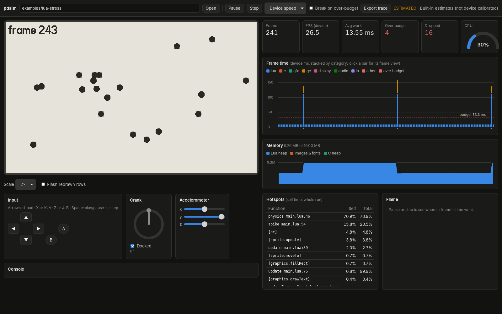

# Playdate Performance Simulator

Run a Playdate game on your computer **at device speed** and see where the
frame time goes, before you put it on hardware.

Panic's Playdate Simulator runs games at full desktop speed, so performance
problems only show up on the device (168 MHz Cortex-M7, 16 MB RAM, 400×240
1-bit display). This simulator never times anything with the host clock.
Every piece of work a game does is charged to a **virtual device clock** using
a cost model you can calibrate on a real Playdate:

- **Lua games** run on a vendored Lua 5.4 patched to count every executed
  opcode, C library call, allocated byte and unit of GC work. The counts are
  multiplied by per-opcode device costs.
- **C games** run their real device build (`pdex.elf`, ARM Thumb-2) in a
  Cortex-M7 emulator (Unicorn). Each basic block is decoded once with
  Capstone and costed by instruction class.
- **API calls** (graphics, sprites, files, …) are implemented natively and
  charged `base + per_pixel·pixels + per_row·rows + …`, measured from the
  work each call actually did.
- **The display** charges a transfer cost per changed row, and the frame
  budget comes from the refresh rate (30 fps by default, 50 max). A frame that
  overruns waits for the next refresh, so it drops frames like the device.



## What you get

- **Desktop app** (Tauri): the game screen at 1×–3×, keyboard / d-pad / crank
  / accelerometer input, and a live perf panel: frame time stacked by category
  against the budget, CPU gauge, dropped and over-budget counters, memory
  (Lua heap, images, C heap), a hotspot table (Lua functions and C symbols),
  a per-frame flame view, a "flash redrawn rows" overlay, **break on
  over-budget frame**, frame stepping, and Chrome/Perfetto trace export.
  **Device-speed** mode paces real time to device time, so the game looks and
  stutters as it would on hardware; **Turbo** runs as fast as possible and
  still reports device timings.
- **Headless runner** for CI: `pdsim run game --frames 600 --report r.json
  --trace t.json --max-over-budget 0`.
- **Calibration**: device benchmark projects and a fitting tool.

## Quick start

```bash
# Optional but recommended: the Playdate SDK provides CoreLibs, the system
# font, and the C API headers (required for C games).
export PLAYDATE_SDK_PATH=~/PlaydateSDK

cargo run --release -p pdsim-cli -- run examples/lua-stress --frames 300
```

```text
300 frames, 10666.7 ms device time, budget 33.33 ms (ESTIMATED calibration)
work avg 11.56 ms  p50 9.26  p95 9.26  max 159.38 (frame 299)
over budget: 5 frames, dropped refreshes: 20, effective fps 28.1
avg per category (ms): lua 9.79, gfx 0.57, gc 0.58, display 0.62
hotspots (self cycles):
     389308366  physics main.lua:46
      87018694  spike main.lua:54
      29067650  [gc]
      20930306  [sprite.update]
```

The desktop app:

```bash
cd app && npm install
npx tauri dev -- -- ../examples/lua-stress
```

C games: build the device binary with the SDK (`make device_bin`, which
needs `arm-none-eabi-gcc`), then point the runner at the game folder or the
`pdex.elf`:

```bash
make -C examples/c-stress device_bin
cargo run --release -p pdsim-cli -- run examples/c-stress --frames 300
```

## CLI

```text
pdsim run <game-dir | Source/ | pdex.elf>
    --frames N               frames to simulate (default 300)
    --input script.json      scripted input (see below)
    --report out.json        summary: percentiles, over-budget frames, hotspots
    --trace out.json         Chrome/Perfetto trace (device time)
    --frames-out f.jsonl     per-frame stats
    --screenshot out.png     last frame
    --calibration prof.json  calibrated profile (default: built-in estimates)
    --data-dir DIR           the game's saved data (default: a temp folder)
    --sdk DIR                Playdate SDK (default: $PLAYDATE_SDK_PATH)
    --max-over-budget N      fail if more than N frames go over budget
    --max-avg-ms X           fail if the average frame work exceeds X ms
    --no-profile             skip per-function attribution (faster)
    -q, --quiet              hide the game's console output
pdsim serve [game]           serve a session over WebSocket for the web UI
pdsim default-calibration    print the built-in profile
```

Input scripts:

```json
{ "events": [
    { "frame": 10, "press": ["a"] },
    { "frame": 12, "release": ["a"] },
    { "frame": 20, "crank": 15.0 },
    { "frame": 30, "crank_to": 90.0, "dock": false },
    { "frame": 40, "accel": [0.0, 1.0, 0.0] }
  ], "crank_per_frame": 0.0 }
```

The full reference, including the report and per-frame formats and exit
codes, is in [docs/cli.md](docs/cli.md). For a walkthrough of profiling
your own game (input scripts, reading hotspots, CI limits), see
[docs/testing-games.md](docs/testing-games.md).

## Accuracy

**Until you calibrate, the numbers are estimates** (reports say so). The
cost model's structure is right — the same work always costs the same, more
work costs proportionally more, and hot paths rank correctly — but absolute
times depend on the per-unit costs. See [docs/calibration.md](docs/calibration.md)
to fit them to your device in a few minutes, and
[docs/accuracy.md](docs/accuracy.md) for what is and isn't modeled.

## Layout

| Path | What |
|---|---|
| `crates/pdsim-core` | virtual clock, cost ledger, scheduler, calibration profiles, reports, trace export |
| `crates/pdsim-gfx` | 1-bit graphics (primitives, bitmaps, fonts, image tables, sprites) with per-call work counts |
| `crates/pdsim-device` | device state shared by both backends: input, file sandbox, feature recording |
| `crates/pdsim-lua` | patched Lua 5.4, Playdate dialect preprocessor, `playdate.*` API, hotspot sampling |
| `crates/pdsim-arm` | `pdex.elf` loader, Cortex-M7 emulation, block costing, the C API |
| `crates/pdsim-runner` | detects Lua vs C games |
| `crates/pdsim-session` | a game on its own thread with pacing, for UIs |
| `crates/pdsim-cli` | `pdsim` headless runner and WebSocket server |
| `app/` | Tauri v2 desktop app (TypeScript + Vite) |
| `calibration/` | built-in estimates and the device bench projects |
| `tools/fit-calibration` | fits a profile to device timings |
| `.claude/skills/playdate-perf-test` | skill for AI agents that test a game's performance with this repo |
| `examples/` | Lua and C samples with known hot paths |
| `docs/` | [testing your game](docs/testing-games.md), [CLI reference](docs/cli.md), [architecture](docs/architecture.md), [session protocol](docs/session-protocol.md), [calibration](docs/calibration.md), [accuracy](docs/accuracy.md), [browser (WASM) port plan](docs/wasm-port.md) |

## Development

```bash
cargo test --workspace         # set PLAYDATE_SDK_PATH to also run the SDK-backed tests
cargo clippy --workspace --all-targets -- -D warnings
```

Golden images for the graphics tests live in `crates/pdsim-gfx/tests/golden`;
regenerate with `UPDATE_GOLDEN=1` after checking the output by eye.

## License

Licensed under either of [Apache License, Version 2.0](LICENSE-APACHE) or
[MIT license](LICENSE-MIT) at your option.

Third-party code: Lua 5.4.9 (MIT, vendored in `crates/pdsim-lua/vendor`),
DejaVu Sans Mono glyphs for the fallback font (Bitstream Vera license). The
C backend links the [Unicorn](https://www.unicorn-engine.org/) emulator,
which is licensed under the **GPL v2**: binaries that include `pdsim-arm`
(the CLI, the app) are therefore distributed under the GPL's terms. The
source code in this repository remains MIT OR Apache-2.0.

This project is not affiliated with Panic Inc. The Playdate SDK is not
included and must never be committed to this repository; the simulator reads
CoreLibs, fonts and C headers from your own SDK install at run time.
